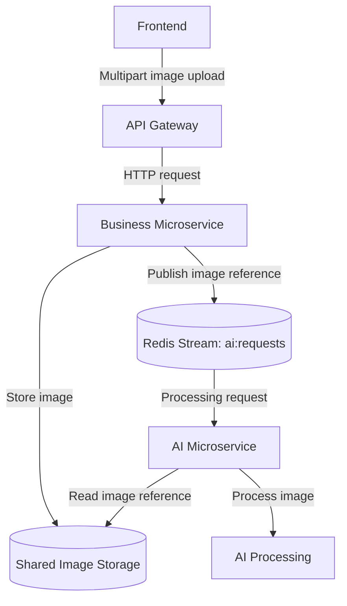

# Image Storage Architecture

## 1. Overview

Kora uses shared temporary filesystem storage to exchange image files between the Business and AI microservices.

This mechanism allows Business to receive and store uploaded images while AI accesses the same files for asynchronous processing.

Image binaries are not transmitted through Redis Streams. Redis messages contain only references to the stored files.

The shared storage mechanism is part of the asynchronous food recognition architecture introduced in HU-039.

## 2. Architectural Design

The Business and AI microservices share a Docker named volume.

The shared volume provides a common filesystem location accessible from both containers.

| Component | Responsibility |
|---|---|
| Business Microservice | Receives uploaded images and stores them temporarily. |
| Shared Storage | Makes image files accessible to both services. |
| Redis Streams | Transports image references and processing metadata. |
| AI Microservice | Retrieves images using the references received through Redis. |

### Storage Architecture



Both Business and AI access the same physical storage volume through their respective container mount points.

## 3. Docker Shared Volume

The shared volume is declared in the root `docker-compose.yml` file.

Volume name:

`ai_images`

Container mount path:

`/tmp/kora-images`

Both services mount the same named volume at this location.

Conceptual configuration:

```yaml
services:
  svc-business:
    volumes:
      - ai_images:/tmp/kora-images

  svc-ai:
    volumes:
      - ai_images:/tmp/kora-images

volumes:
  ai_images:
```

The named volume allows image files to remain accessible across the lifecycle of individual containers.

The volume is managed by Docker and is independent of the container filesystem.

## 4. Environment Configuration

The storage directory is configured through the `AI_IMAGES_DIR` environment variable.

### 4.1 Docker Environment

Both services use:

```env
AI_IMAGES_DIR=/tmp/kora-images
```

The path corresponds to the shared volume mount point inside the containers.

### 4.2 Local Development Environment

Both services use:

```env
AI_IMAGES_DIR=../tmp/kora-images
```

This configuration allows Business and AI to access the same project-level temporary directory when running locally.

### 4.3 Configuration Files

The environment examples are maintained in:

| Service | Local Configuration | Docker Configuration |
|---|---|---|
| Business | `svc-business/.env.example` | `svc-business/.env.docker.example` |
| AI | `svc-ai/.env.example` | `svc-ai/.env.docker.example` |

Actual environment files must not be committed to the repository.

## 5. Image Storage Lifecycle

The image lifecycle is designed around asynchronous processing.

### 5.1 Upload and Storage

1. The user uploads an image through the frontend.
2. API Gateway forwards the multipart request to Business.
3. Business validates the uploaded image.
4. Business generates a UUID-based filename.
5. Business stores the image in the configured directory.
6. Business creates an image reference for the processing event.

Original filenames are not used as filesystem paths.

### 5.2 Image Reference

The image reference follows this format:

```text
storage://images/<filename>
```

Example:

```text
storage://images/550e8400-e29b-41d4-a716-446655440000.jpg
```

The reference identifies the stored image without including its binary content.

The AI service resolves this reference to the corresponding file in its shared storage directory.

The `storage://` scheme is an application-level reference, not an HTTP URL.

### 5.3 Processing

When AI receives a processing request, it uses the image reference to locate and read the corresponding file.

The shared volume avoids the need to upload the image again or transfer it through Redis.

### 5.4 Cleanup Strategy

Images are temporary resources and should not be retained indefinitely.

The agreed lifecycle strategy is:

| Scenario | Expected Behavior |
|---|---|
| Successful processing | Delete the image after processing no longer requires it. |
| Recoverable processing failure | Retain the image while the request remains eligible for retry. |
| Permanent processing failure | Delete the image after the failure is finalized. |
| Request timeout or expiration | Remove the image when no further processing attempt is expected. |
| Failed initial event publication | Business deletes the image associated with the failed request. |

Coordinated cleanup after AI processing, retry handling, and abandoned-file cleanup must be implemented as part of the asynchronous processing lifecycle.

## 6. Storage and Messaging Separation

Redis Streams is used exclusively for event and metadata transport.

Image binaries must not be stored inside Redis messages.

Example processing event:

```json
{
  "event_id": "evt-001",
  "event_type": "ai.processing.requested",
  "timestamp": "2026-11-24T18:00:00Z",
  "data": {
    "request_id": "req-001",
    "user_id": "user-123",
    "operation": "food_recognition",
    "payload": {
      "image_reference": "storage://images/food-001.jpg"
    }
  }
}
```

This separation provides the following benefits:

- Smaller Redis messages.
- Reduced message serialization overhead.
- No binary image duplication in Redis.
- Independent image storage and event transport.
- Shared file access between Business and AI.

## 7. Security Considerations

The image storage implementation must follow these security requirements:

1. Generate UUID-based filenames for uploaded images.
2. Never use original user-provided filenames as filesystem paths.
3. Validate uploaded image content types before storage.
4. Restrict image access to the services that require it.
5. Avoid exposing internal filesystem paths through public API responses.
6. Do not include image binaries in Redis events.
7. Avoid logging image contents or sensitive file metadata.
8. Delete temporary images when their processing lifecycle is complete.
9. Ensure that image references cannot be used to access arbitrary filesystem paths.

Image references must be resolved safely within the configured storage directory.

## 8. Configuration and Verification

### 8.1 Verify Docker Volume Mounts

Inspect the service configuration:

```powershell
docker compose config --services
```

To verify the actual mounts without displaying environment secrets:

```powershell
docker inspect kora-svc-business-1
docker inspect kora-svc-ai-1
```

Container names may vary depending on the Compose project configuration.

Inspect the `Mounts` section and verify that both services use the same Docker volume for `/tmp/kora-images`.

### 8.2 Verify Storage Directory

Business:

```powershell
docker compose exec svc-business python -c "from django.conf import settings; print(settings.AI_IMAGES_DIR)"
```

AI:

```powershell
docker compose exec svc-ai python -c "from app.config import settings; print(settings.AI_IMAGES_DIR)"
```

The exact AI configuration import may vary with the application's configuration module.

Expected Docker directory:

```text
/tmp/kora-images
```

### 8.3 Shared Storage Verification

The shared storage configuration must allow:

- Business to create a file in the configured directory.
- AI to read the same file.
- AI to access the same filename and contents.
- Temporary test files to be removed after verification.

Bidirectional file access was verified between the Business and AI containers during implementation.

## 9. Failure Considerations

The storage and messaging operations are separate operations.

Business stores the image before publishing the corresponding Redis event.

If event publication fails, Business removes the stored image and reports the failure to the caller.

If a message is successfully published but AI becomes temporarily unavailable, the image must remain available while the request can still be recovered.

The asynchronous processing implementation must coordinate message acknowledgment and image cleanup to avoid deleting files that are still required by pending requests.

## 10. Architectural Decisions

1. Shared filesystem storage is used instead of object storage for the current implementation.
2. Docker named volumes provide shared storage between Business and AI.
3. Both services use `/tmp/kora-images` as their Docker storage path.
4. Local development uses `../tmp/kora-images`.
5. Images are identified using UUID-based filenames.
6. Redis Streams transports image references rather than binary image data.
7. Images are temporary and must be removed after their processing lifecycle is complete.
8. Recoverable failures must preserve image availability while retries remain possible.
9. Storage cleanup and message processing must be coordinated.

## 11. Scope and Future Improvements

The current implementation establishes the shared storage foundation required for asynchronous food recognition.

Future implementation stages must complete:

- AI image retrieval and processing.
- Cleanup after successful processing.
- Cleanup after permanent failures.
- Recovery-aware image retention.
- Timeout-based cleanup of abandoned files.
- Coordination between Redis message acknowledgment and image deletion.

The current architecture intentionally avoids introducing an external object storage service until the system requires one.
