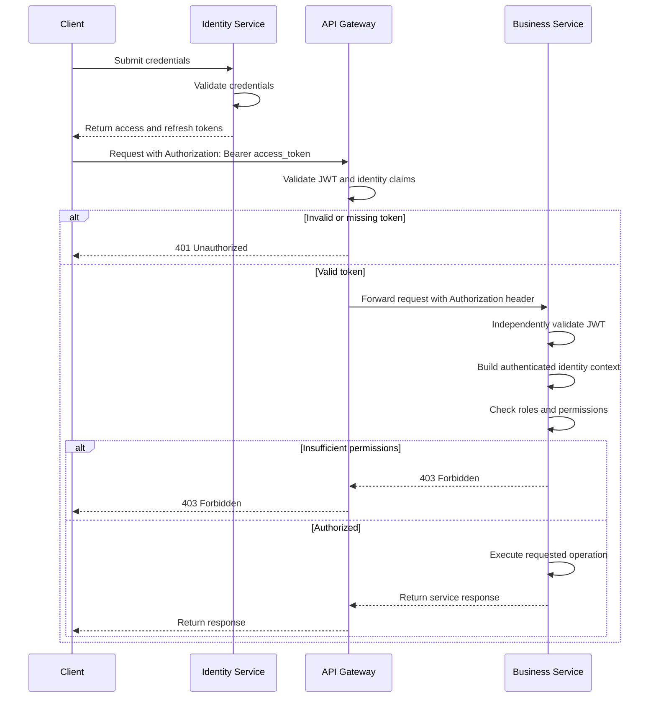

# HU-031 — Identity Propagation Between Microservices

## 1. Purpose

Implement and document a secure identity propagation mechanism that allows Kora microservices to identify and authorize the user who originates a request.

The identity is transmitted through a signed JSON Web Token (JWT), allowing the Gateway and downstream microservices to independently validate the user's identity and permissions.

## 2. Identity Contract

The identity is transmitted using the HTTP authorization header:

```http
Authorization: Bearer <access_token>
```

The access token must contain the following claims:

| Claim | Type | Description |
|---|---|---|
| `user_id` | String | Unique identifier of the authenticated user. |
| `token_type` | String | Token type. Must be `access`. |
| `roles` | Array of strings | Roles assigned to the user. |
| `permissions` | Array of strings | Permissions granted to the user. |
| `exp` | Integer | Token expiration timestamp. |
| `iat` | Integer | Token issuance timestamp. |

The token must be signed using the HS256 algorithm.

## 3. Identity Validation Mechanism

Every protected request must pass the following validation process:

1. Extract the JWT from the `Authorization` header.
2. Verify that the header uses the `Bearer` authentication scheme.
3. Validate the JWT signature using the configured signing key.
4. Verify that the token has not expired.
5. Verify that the token type is `access`.
6. Validate that `user_id` is present and contains a valid identifier.
7. Validate that `roles` and `permissions` are lists of strings.
8. Create an authenticated identity context containing the validated user information.

If any validation step fails, the request must be rejected with an appropriate authentication error, normally HTTP `401 Unauthorized`.

The signing key must be configured consistently between Identity and Business services through the `JWT_SIGNING_KEY` environment variable. It must not be exposed in source code or transmitted between services.

## 4. Service Responsibilities

### 4.1 Identity Service

The Identity service is responsible for:

- Authenticating users through their credentials.
- Issuing signed access and refresh tokens.
- Including the required identity claims in access tokens.
- Managing user roles and permissions.
- Maintaining the validity and expiration of issued tokens.

The Identity service is the source of authenticated identity information.

### 4.2 API Gateway

The Gateway acts as the entry point for requests to protected services.

Its responsibilities are:

- Receive incoming client requests.
- Validate the access token before forwarding protected requests.
- Reject requests with missing, invalid, or expired credentials.
- Preserve and propagate the original `Authorization` header to the destination microservice.
- Prevent clients from establishing trusted identity through arbitrary identity headers.
- Forward the request to the appropriate downstream service.

The Gateway must not replace the original authenticated identity with values supplied through untrusted headers.

### 4.3 Business Service

The Business service is responsible for independently validating the JWT received from the Gateway.

Its responsibilities are:

- Validate the JWT signature and expiration.
- Verify the `access` token type.
- Extract the validated `user_id`, `roles`, and `permissions`.
- Create the authenticated request identity.
- Enforce role-based and permission-based authorization.
- Restrict access to resources according to ownership rules.
- Use the authenticated `user_id` instead of trusting user identifiers supplied in request bodies or query parameters.

The Business service must not assume that a request is trusted merely because it originated from the Gateway.

## 5. Authentication and Authorization Flow

The complete request flow is described below:



### Request Processing Stages

| Stage | Component | Responsibility |
|---|---|---|
| 1 | Client | Sends credentials to Identity. |
| 2 | Identity | Validates credentials and issues JWT tokens. |
| 3 | Client | Sends a protected request with the access token. |
| 4 | Gateway | Validates the token and forwards the request. |
| 5 | Business | Independently validates the token and builds the identity context. |
| 6 | Business | Checks the user's permissions and resource ownership. |
| 7 | Business | Executes the operation or rejects the request. |
| 8 | Gateway | Returns the downstream response to the client. |

## 6. Authorization Rules

Authentication and authorization are separate responsibilities.

- **Authentication** determines whether the request contains a valid identity.
- **Authorization** determines whether the authenticated identity can perform the requested operation.

The Business service uses the following permission classes:

| Permission Class | Responsibility |
|---|---|
| `HasBusinessPermission` | Verifies authentication and the required business permission. |
| `HasSelfBusinessPermission` | Verifies permission and restricts operations to the authenticated user's own identity. |
| `HasOwnedBusinessPermission` | Verifies permission and checks that the requested object belongs to the authenticated user. |

The authenticated identity must be obtained from `request.user.user_id`.

When a request includes a `user_id` supplied by the client, the service must not use it as the source of authentication. If the operation is restricted to the current user, the supplied identifier must match the authenticated identity.

## 7. Security Requirements

The implementation must comply with the following requirements:

1. Only valid access tokens may authenticate protected requests.
2. JWT signatures must be verified using HS256 and the configured signing key.
3. Expired tokens must be rejected.
4. Tokens with an invalid or missing `token_type` must be rejected.
5. User identity and authorization claims must come from the validated token.
6. The `Authorization` header must be propagated to downstream services.
7. Identity must not be established using untrusted headers such as:
   - `X-User-ID`
   - `X-User-Roles`
   - `X-User-Permissions`
8. Each microservice that makes authorization decisions must validate the identity independently.
9. Users must not access resources belonging to other users unless explicitly authorized.
10. Signing keys must be stored as protected environment configuration or secrets.

## 8. Expected HTTP Responses

| HTTP Status | Meaning | Scenario |
|---|---|---|
| `200 OK` | Request successful. | Authenticated and authorized request completed. |
| `201 Created` | Resource created. | Authenticated and authorized resource creation. |
| `401 Unauthorized` | Authentication failed. | Missing, invalid, expired, or incorrectly formatted token. |
| `403 Forbidden` | Authorization failed. | Valid identity without the required permission. |
| `404 Not Found` | Resource not found. | Requested resource does not exist or is not available to the user, according to the endpoint's behavior. |

## 9. Configuration Requirements

The Identity and Business services must use the same JWT signing key.

Business configuration:

```env
JWT_SIGNING_KEY=<shared-secret>
```

The secret must be supplied through the service environment or a secret-management mechanism.

It must not be committed to the repository or included in application logs.

## 10. Acceptance Criteria

The identity propagation implementation is considered compliant when:

- Identity issues access tokens containing the required claims.
- The Gateway validates access tokens before forwarding protected requests.
- The Gateway propagates the original `Authorization` header.
- Business independently validates the JWT.
- Business creates the authenticated identity from validated claims.
- Authorization checks use the authenticated user's roles and permissions.
- Resource ownership is validated where required.
- Missing, invalid, and expired tokens are rejected.
- Requests with insufficient permissions are rejected.
- Arbitrary client-provided identity headers are not trusted.

## 11. Scope and Responsibilities Summary

| Component | Authentication | Authorization | Identity Propagation |
|---|---|---|---|
| Identity | Validates credentials and issues tokens. | Manages roles and permissions. | Provides signed identity claims. |
| API Gateway | Validates access tokens. | Enforces access to protected gateway routes, where configured. | Forwards the original authorization header. |
| Business | Independently validates access tokens. | Enforces permissions and resource ownership. | Builds the authenticated request identity. |

This contract establishes a consistent and verifiable identity mechanism across Kora services, ensuring that each protected operation is associated with an authenticated user and authorized according to the user's permissions.

