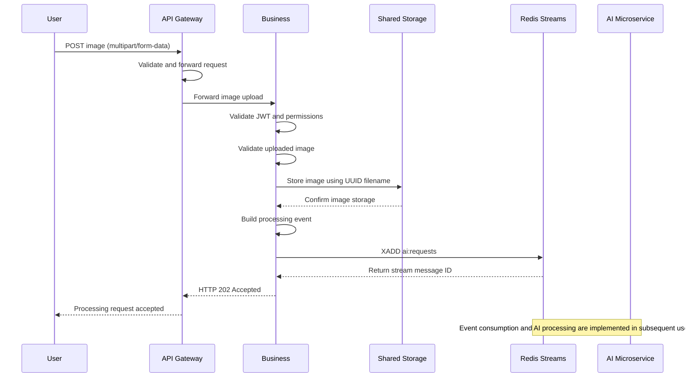

# HU-039 — Business Event Publishing

## 1. Purpose

Implement a reusable event publishing mechanism in the Business microservice using Redis Streams.

The implementation enables Business to publish asynchronous processing requests to the AI microservice without requiring long-running synchronous HTTP requests.

The first business operation integrated with this mechanism is food recognition through image uploads.

This user story establishes the event publishing component, its integration with the food recognition endpoint, and the required infrastructure for temporary image sharing between Business and AI.

## 2. Scope

The implementation includes:

- A reusable event contract and validation component.
- A generic Redis Streams event publisher.
- Integration with the food recognition endpoint.
- Multipart image upload support through the API Gateway.
- Temporary image storage using a shared Docker volume.
- JWT authentication and RBAC authorization.
- Error handling for failed event publication.
- Automated tests for messaging and endpoint behavior.

The implementation does not include AI event consumption, image recognition execution, result consumption, or complete message recovery. These responsibilities belong to subsequent user stories.

## 3. Architecture

The food recognition request follows this communication architecture:

```text
                     Frontend
                         |
                         | HTTP multipart/form-data
                         v
                    API Gateway
                         |
                         | HTTP multipart/form-data
                         v
                  Business Microservice
                         |
              +----------+----------+
              |                     |
              v                     v
       Shared Image Storage    Event Publisher
              |                     |
              |                     v
              |                Redis Streams
              |                 ai:requests
              |                     |
              v                     v
        AI Microservice <------------+
        (Future consumer)
```

Business and AI share a temporary storage volume to access image files without transmitting binary image data through Redis.

Redis Streams transports event metadata and image references.

## 4. Event Publishing Component

The publishing mechanism is implemented as a reusable component within the Business microservice.

### 4.1. Component Structure

| File | Responsibility |
|---|---|
| `messaging/contracts.py` | Defines event types, stream mappings, event generation, and validation. |
| `messaging/publisher.py` | Validates and publishes events to Redis Streams. |
| `messaging/tests/test_contracts.py` | Tests event generation and contract validation. |
| `messaging/tests/test_publisher.py` | Tests event publishing behavior. |

### 4.2. Event Types

The following event types are defined:

| Event Type | Purpose |
|---|---|
| `ai.processing.requested` | Requests an AI processing operation. |
| `ai.processing.completed` | Reports successful processing. |
| `ai.processing.failed` | Reports processing failure. |

### 4.3. Stream Mapping

The publisher uses a centralized mapping between event types and Redis Streams.

| Stream | Direction | Purpose |
|---|---|---|
| `ai:requests` | Business → AI | AI processing requests. |
| `ai:results` | AI → Business | Processing results. |

The publisher validates the event before attempting to publish it.

Events are serialized as JSON and stored in Redis Streams using the `XADD` operation.

### 4.4. Reusability

The publisher is not restricted to food recognition.

Other Business operations can reuse the same component by providing a valid event following the established contract.

This avoids duplicating Redis connection, serialization, validation, and publishing logic across business operations.

## 5. Food Recognition Integration

### 5.1. Endpoint

The food recognition endpoint is implemented in:

`svc-business/nutrition/recognition.py`

The route is registered in:

`svc-business/nutrition/urls.py`

The external Gateway endpoint is:

```http
POST /api/business/food-recognition/
```

The corresponding Business endpoint is:

```http
POST /api/food-recognition/
```

### 5.2. Request Format

The endpoint accepts an image using `multipart/form-data`.

The uploaded file must use one of the supported content types:

- `image/jpeg`
- `image/png`
- `image/webp`

The endpoint rejects requests without an image or with an unsupported content type.

### 5.3. Authentication and Authorization

The endpoint requires JWT authentication and Business permission validation.

Required permission:

`food_recognition.create_self`

This permission is assigned to the USER and ADMIN roles through the Identity migration:

`0013_add_food_recognition_permission.py`

The endpoint uses the existing Business authentication and authorization mechanisms.

### 5.4. Image Storage

Before publishing the event, Business stores the uploaded image in the shared temporary directory.

The filename is generated using UUID to prevent collisions and avoid using user-provided filenames as storage paths.

The image is referenced in the event using:

`storage://images/<filename>`

The binary image is not included in the Redis message.

The shared storage configuration is documented separately in:

`docs/architecture/IMAGE_STORAGE.md`

## 6. Food Recognition Request Flow

The endpoint executes the following operations:

1. Receives the multipart image upload.
2. Validates the authenticated identity and required permission.
3. Validates the uploaded image.
4. Generates a UUID-based filename.
5. Stores the image in the configured temporary directory.
6. Generates a unique request identifier.
7. Builds an `ai.processing.requested` event.
8. Includes the operation name `food_recognition`.
9. Adds the image reference to the event payload.
10. Publishes the event through the generic Redis publisher.
11. Returns HTTP 202 Accepted when publication succeeds.

### Sequence Diagram



## 7. Event Contract

The publisher uses the standardized event structure established in HU-038.

Example food recognition request:

```json
{
  "event_id": "unique-event-identifier",
  "event_type": "ai.processing.requested",
  "timestamp": "2026-11-24T18:00:00Z",
  "data": {
    "request_id": "unique-request-identifier",
    "user_id": "user-identifier",
    "operation": "food_recognition",
    "payload": {
      "image_reference": "storage://images/food-001.jpg"
    }
  }
}
```

### 7.1. Event Validation

The contract validation component checks:

- Event structure.
- Required top-level fields.
- Supported event types.
- Timestamp presence and format.
- Required request information.
- Operation information.
- Payload requirements for processing requests.
- Result or error information for completed and failed events.

Invalid events are rejected before publication.

### 7.2. Event Identification

Each event receives a unique `event_id`.

Each processing request receives a unique `request_id`.

The request identifier allows subsequent processing results to be associated with their original requests.

## 8. API Responses

### 8.1. Successful Publication

When the event is successfully published, Business responds with:

```http
HTTP/1.1 202 Accepted
```

The response includes the request identifier, processing status, and a descriptive message.

Example:

```json
{
  "request_id": "unique-request-identifier",
  "status": "processing",
  "message": "Food recognition request accepted for processing."
}
```

HTTP 202 indicates that the request was accepted for asynchronous processing. It does not indicate that food recognition has already completed.

### 8.2. Invalid Image

If the uploaded image is missing or has an unsupported content type, Business rejects the request with:

`400 Bad Request`

### 8.3. Redis Publishing Failure

If Redis cannot accept the event:

- Business logs the publishing error.
- Business deletes the temporary image associated with the failed publication.
- Business does not report the request as accepted.
- Business responds with:

`503 Service Unavailable`

## 9. API Gateway Multipart Support

The API Gateway Business proxy was updated to support multipart/form-data requests.

The implementation is located in:

`api-gateway/gateway/views.py`

The Business proxy now forwards multipart request bodies without converting them into JSON.

Existing JSON request forwarding behavior is preserved.

This change allows uploaded images to reach Business through the Gateway without modifying the original binary request body.

## 10. Security Requirements

The implementation follows these security requirements:

1. The food recognition endpoint requires a valid JWT access token.
2. The `food_recognition.create_self` permission is required.
3. User identity is obtained through the existing authenticated identity mechanism.
4. Uploaded images are validated before storage.
5. UUID-based filenames are used instead of original filenames.
6. Original filenames are not used to construct filesystem paths.
7. Redis receives image references rather than binary image data.
8. Redis connection configuration is provided through environment variables.
9. Sensitive configuration must not be committed to the repository.
10. Publishing errors must not expose internal credentials or secrets.

## 11. Error Handling

The event publisher validates events before attempting publication.

If validation fails, the event is rejected.

If Redis publication fails, the exception is logged and propagated to the endpoint so that the request is not reported as successfully accepted.

The endpoint also removes the stored image associated with a failed publication attempt.

The implementation does not include a transactional outbox. Redis publication and image storage are separate operations.

Recovery of messages already published, consumer retries, and coordinated cleanup after AI processing are responsibilities of subsequent user stories.

## 12. Testing

The implementation includes automated tests for the event contract, publisher, and food recognition endpoint.

The tests verify:

- Event generation.
- Event structure validation.
- Supported event types.
- Invalid event rejection.
- Successful Redis event publication.
- Redis publishing failure handling.
- Image upload validation.
- Missing image rejection.
- Unsupported image content type rejection.
- Successful food recognition request acceptance.
- Authentication and authorization behavior.
- Temporary image cleanup when publication fails.

Existing Business tests were also updated to use JWT authentication and the required RBAC permissions.

### Full Test Suite

The complete Business test suite was executed using:

```powershell
docker compose exec svc-business python manage.py test -v 2
```

Result:

| Metric | Result |
|---|---:|
| Tests executed | 108 |
| Passed | 108 |
| Failed | 0 |
| Errors | 0 |

## 13. Acceptance Criteria

HU-039 is considered implemented when:

- A reusable Redis Streams publisher is available in Business.
- A standardized event contract is defined and validated.
- Supported event types are mapped to their corresponding streams.
- Invalid events are rejected before publication.
- The food recognition endpoint accepts valid multipart image uploads.
- The endpoint enforces authentication and RBAC permissions.
- Images are stored using UUID-based filenames.
- Images are accessible through the shared storage configuration.
- Food recognition requests are published to `ai:requests`.
- Redis messages contain image references rather than binary image data.
- Successful publication returns HTTP 202 Accepted.
- Redis publishing failures return HTTP 503 Service Unavailable.
- Failed publication attempts clean up the associated temporary image.
- Automated tests pass successfully.

## 14. Out of Scope

The following functionality is not implemented as part of HU-039:

- AI consumer implementation.
- Actual image recognition execution.
- AI result publication.
- Business result consumption.
- Consumer group management for processing.
- Pending message recovery.
- Retry policies for AI processing.
- Coordinated image cleanup after successful processing.
- Final food selection and consumption registration.

These responsibilities will be addressed in subsequent user stories.

## 15. Implementation Summary

HU-039 establishes the Business-side event publishing mechanism and integrates it with food recognition requests.

The implementation provides a reusable messaging component, a validated event contract, an authenticated image upload endpoint, and temporary image storage shared between Business and AI.

The result is a foundation for asynchronous AI processing that separates request acceptance from processing execution while maintaining clear service responsibilities and communication contracts.
